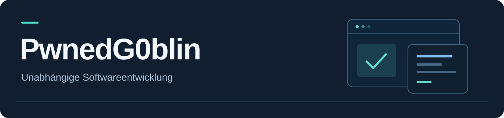

  

# PwnedG0blin — Apps für Mac, iPhone, iPad und Android

**Unabhängige Softwareentwicklung: Android-Emulation, Windows- und Linux-Virtualisierung, Videobearbeitung und spielerische Umweltbildung.**

**Independent software development:** Android emulation, Windows ARM64 and Ubuntu ARM virtual machines for Mac, video editing for iPhone and iPad, and nature learning games for children.

[**Website**](https://pwnedg0blin.pages.dev/) · [**Projektübersicht / Project overview**](https://pwnedg0blin.pages.dev/projekte) · [**Support**](https://pwnedg0blin.pages.dev/support)

[Projekte / Projects](#projekte--projects) · [Testversionen / Downloads](#testversionen--downloads) · [Kontakt und Unterstützung](#kontakt-und-unterstützung)

## Projekte / Projects

### [Stratovo — Android, Windows & Ubuntu for Mac](https://github.com/PwnedG0blin/OpenGuest)

Kostenlose Open-Source-App für Android-Emulation sowie Windows-ARM64- und Ubuntu-ARM-VMs auf Macs mit Apple Silicon. APK-Installation, eigene Playerfenster und dauerhaft gespeicherte Gastsysteme. **macOS 14+ · Öffentliche Testversion.**

Free, open-source macOS app for Android emulation, Windows ARM64 and Ubuntu ARM virtual machines on Apple silicon, with APK installation and persistent guest storage. One guest runs at a time. **Public test version.** [English documentation](https://github.com/PwnedG0blin/OpenGuest#readme).

### [Scenalto — Video Editor for iPhone & iPad](projects/Scenalto)

Videoeditor für iPhone und iPad mit Touch-Bedienung und präzisem Videoschnitt. **iOS / iPadOS · In Entwicklung.**

Video editor for iPhone and iPad, designed for touch controls and precise video editing. **In development.**

### [Mirravel — iPhone Mirroring Diagnostics for Mac](projects/Mirravel)

Mirravel richtet sich an Nutzerinnen und Nutzer in der Europäischen Union und verfolgt das Ziel, Apples regionale Einschränkung für iPhone Mirroring experimentell zu umgehen. Dafür bietet es Diagnose und Änderungen auf der Mac-Seite mit Sicherung und Rücknahme eigener Änderungen. Am 23.10.2026 hat PwnedG0blin eine funktionierende iPhone-Mirroring-Verbindung aus der EU mit iOS 27.2 RC und macOS 27.2 RC bestätigt. Prüfungen auf dem iPhone und spätere Systemupdates können die Verbindung weiterhin beeinflussen.

Mirravel is intended for users in the European Union and aims to experimentally bypass Apple’s regional restriction on iPhone Mirroring. It provides diagnostics and Mac-side configuration changes with backup and restore of its own changes. On 23 October 2026, PwnedG0blin confirmed a working iPhone Mirroring connection from within the EU with iOS 27.2 RC and macOS 27.2 RC. iPhone-side eligibility checks and future system updates may still affect connectivity.

Kostenloser Open-Source-Helfer für iPhone-Mirroring-Diagnose und experimentelle Mac-Konfiguration mit Sicherung und Rücknahme eigener Änderungen. **macOS 15+ · Apple Silicon oder Intel mit T2 · 0.2.1 Beta.**

Free, open-source macOS helper for iPhone Mirroring diagnostics and experimental configuration, including backup and restore of its own changes. **Experimental beta; a successful mirroring connection is not guaranteed.**

### [Wimmelwelt: Naturdetektive — Nature Learning & Hidden Object Game for Kids](projects/Naturdetektive)

Kostenloses Wimmel- und Lernspiel für Kinder über Tiere, Lebensräume und Umweltschutz. Für iPhone, iPad und Android geplant, ohne Werbung und Tracking, mit lokalem Spielfortschritt. **In Entwicklung.**

Free nature learning and hidden object game for kids about wildlife, habitats and environmental protection. Planned for iPhone, iPad and Android, with no ads or tracking and locally saved progress. **In development.**

**Bisherige Namen / Previous names:** Pixelkoje → Stratovo · FrameForge → Scenalto. **Wimmelwelt: Naturdetektive** behält seinen Namen; unter dem App-Symbol heißt sie **Naturdetektive**.

## Testversionen / Downloads

- **[Stratovo: Einrichtung und Mac-Test-Builds](https://github.com/PwnedG0blin/OpenGuest#install-or-build)** — Android-Emulator, Windows-ARM64- und Ubuntu-ARM-VMs; Voraussetzungen und Grenzen stehen direkt beim Projekt.
- **[Mirravel 0.2.1 Beta](https://github.com/PwnedG0blin/PwnedG0blin/releases/tag/mirravel-v0.2.1-beta)** — Mac-App, Quellen und Prüfsummen. Wiederanwendung nach macOS-Updates; erfolgreiche Verbindung mit iOS und macOS 27.2 RC bestätigt.
- Scenalto und Naturdetektive befinden sich in Entwicklung; auf diesen Projektseiten wird kein bereits veröffentlichter App-Store-Download behauptet.

Funktionsumfang und Verfügbarkeit richten sich nach dem jeweiligen Entwicklungsstand. Tests, Lizenzhinweise und bekannte Einschränkungen stehen direkt beim Projekt.

## Austausch und Beiträge

Fehlerberichte, konkrete Verbesserungsvorschläge und Beiträge zu öffentlichen Quellcodes sind willkommen. Für Stratovo: [Beitragshinweise](https://github.com/PwnedG0blin/OpenGuest/blob/main/CONTRIBUTING.md) und [Fehlerberichte](https://github.com/PwnedG0blin/OpenGuest/issues). Für Mirravel: [Fehlerdiagnose](projects/Mirravel#fehlerdiagnose). Vor dem Teilen von Protokollen private Angaben entfernen.

## Kontakt und Unterstützung

[**X · @PwnedG0blin**](https://x.com/PwnedG0blin) · [**GitHub Sponsors · Entwicklungsarbeit unterstützen**](https://github.com/sponsors/PwnedG0blin) · [**Patreon · Entwicklungsarbeit unterstützen**](https://www.patreon.com/cw/PwnedG0blinApp) · [**GoFundMe · Naturdetektive**](https://www.gofundme.com/u/360e08e6-c72f-4696-b609-a74f4ef3295d)

Auf X teile ich Neuigkeiten und Einblicke. GitHub Sponsors und Patreon unterstützen meine gesamte Entwicklungsarbeit an Stratovo, Scenalto, Mirravel und Wimmelwelt: Naturdetektive. GitHub Sponsors bietet monatliche Unterstützung ab $2 und eine einmalige Unterstützung für $10. Die GoFundMe-Kampagne gilt der kostenlosen Umwelt-Lern-App für Kinder.

GitHub Sponsors and Patreon support development across all four projects. The GoFundMe campaign is dedicated to the free nature learning game for children.

---

**Projektentwicklung / Developed by: PwnedG0blin** · Urheber- und Lizenzhinweise gelten gemäß der Dokumentation des jeweiligen Projekts.

